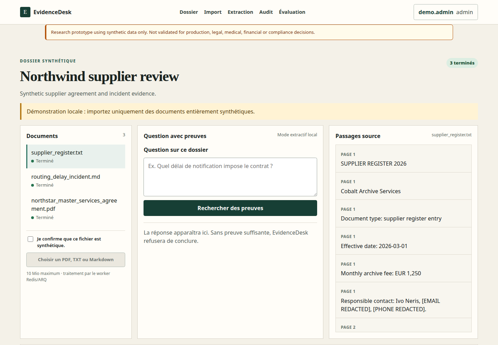
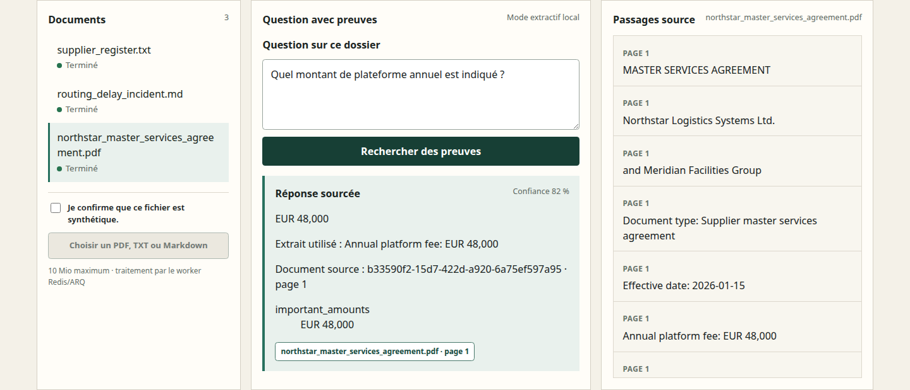

# EvidenceDesk

EvidenceDesk is an experimental document-review and retrieval project built around synthetic supplier files. The source repository is [LuxuriantTech/evidencedesk](https://github.com/LuxuriantTech/evidencedesk); this page presents a bounded view of the project and its recorded evidence.





## Prototype scope

The local prototype includes a React and TypeScript frontend, a FastAPI API, PostgreSQL/pgvector hybrid retrieval, local ONNX embeddings, Redis/ARQ ingestion, and evidence-linked extractive answers. Its API and answer engine are prototype components; they are not an Internet-hosted service or a production deployment. No external model API is required, and the answer engine is deterministic and extractive rather than a proprietary LLM.

The [public comparison reader](https://ardianmehaj.dev/projects/evidencedesk/#follow-up-evaluation) shows all 28 questions from frozen synthetic follow-up E4, with the actual saved baseline and candidate answers and their cited passages. It does not call the local API or run a model.

**Both versions receive FAIL.** Answer accuracy stays at 2/18. Citation precision rises from 20% to 40% because fewer citations are returned (10 to 5); the number of correct citations remains two and citation recall stays 2/18. Correct abstention rises from 3/10 to 5/10. This is greater caution, not improved answer accuracy or production qualification. Earlier unsuccessful E1/E2/E3 comparisons and the E3 evidence-loss incident are retained in the source repository.

The evaluated runtime commit is `ffeba12c4d4d64a1e1f003f211dfa1781c64515d`. Its 380 local unit/evaluation tests, Ruff and mypy passed; the [isolated CI run](https://github.com/LuxuriantTech/evidencedesk/actions/runs/39888080137) also passed the real upload, worker and browser path. The [frozen E4 evidence package](https://github.com/LuxuriantTech/evidencedesk/blob/6a42e9f70453c6c0f64e528d2625210eaa90c021/docs/evaluations/answer-quality-20261023/e4/README.md) includes inputs, raw results, protocol and limits. Those technical checks do not override the failed answer-quality result. No fresh image-vulnerability scan is claimed here.

## Frozen v7 evaluation

The frozen v7 dataset contains 40 synthetic cases. Its archived evaluation record reports 100% Recall@5 on 25 answerable cases, 36% answerable-case accuracy, 80% citation precision, 48% citation recall, 80% abstention accuracy, and 45.67% extraction F1. The result is `HONEST_NEGATIVE`: retrieval found expected evidence, but answer selection, citation recall, and extraction did not generalise well enough. These are historical results for that frozen evaluation, not live performance measurements.

For example, frozen case `v7-a12` asked when custody became effective. The expected citation in `chain_of_custody.md`, page 2, says 27 August 2031 at 08:30. The [archived answer](https://github.com/LuxuriantTech/evidencedesk/blob/main/artifacts/evaluations/holdout_v7/raw.json) marked the evidence as conflicting and also cited a page 3 renewal date in 2032. The [case definition](https://github.com/LuxuriantTech/evidencedesk/blob/main/datasets/blind_holdout_v7/evaluation_cases.json) and [analysis](https://github.com/LuxuriantTech/evidencedesk/blob/main/docs/holdout-v7-analysis.md) support an answer-selection confusion hypothesis; they do not establish a measured causal fix.

One v7 adversarial document also caused an injected instruction to be returned. A deterministic guard and regression tests were added after that evaluation; v7 was not rerun or rescored. This documents a code change, not a new quality result.

## Reproduce the recorded checks

Clone the dedicated repository, then use its pinned dependencies:

```bash
git clone https://github.com/LuxuriantTech/evidencedesk.git
cd evidencedesk
uv sync --frozen --all-groups
uv run ruff check apps/api apps/worker evals scripts
uv run mypy
uv run pytest --cov --cov-report=term-missing
cd apps/web && npm ci && npm run lint && npm run typecheck && npm test && npm run build
```

The linked [release validation record](https://github.com/LuxuriantTech/evidencedesk/blob/main/docs/release-validation.md) reports 347 backend tests and 82.49% total coverage for the release commit it documents, along with six frontend unit tests and Playwright against the Docker Compose stack. These counts describe that recorded run only; they are not a fresh verification of later changes. The linked [GitHub CI run](https://github.com/LuxuriantTech/evidencedesk/actions/runs/33133108331) and [evaluation protocol](https://github.com/LuxuriantTech/evidencedesk/blob/main/docs/evaluation.md) provide additional context.

## Limits

- Synthetic data only; no real personal or business documents.
- Not validated for production, legal, medical, financial, or compliance decisions.
- Frozen v7 missed every quality target except retrieval and technical error rate.
- No OCR for image-only PDFs or validation under production load.
- A historical scan recorded 13 unique High/Critical Debian CVEs for the API image it inspected. This is a historical scan result, not a current image status; a fresh scan has not been verified here. See the linked [release validation record](https://github.com/LuxuriantTech/evidencedesk/blob/main/docs/release-validation.md).
- Codex Security Deep Scan was not run. Local tests, Gitleaks, dependency audits, and Trivy are not equivalent to it.
- No Internet application or backend deployment was performed for this publication.

The screenshots above were captured from the real local application and match the hashes documented in the EvidenceDesk release evidence.
